Voting App : conteneurisation avec Docker, Compose et Swarm

Mini-projet 3DOKR, réalisé par Simon MENNECHET et Thomas MARTIN.

Application distribuée de vote (« Cats vs Dogs ») déployée avec Docker. Le projet est passé de scripts bash lancés à la main à :

un Dockerfile par module ;
un docker-compose.yml (réseaux isolés, volumes, healthchecks, dépendances) ;
un cluster Docker Swarm de 3 VM (1 manager, 2 workers) créé avec Vagrant et VMware, sans Docker dans Docker.

Sommaire

Architecture
Structure du dépôt et organisation Git
Lancer le projet avec Docker Compose
Déploiement sur un cluster Docker Swarm
Choix techniques et bonnes pratiques
Liste des modifications du code source
Correspondance avec les anciens scripts run/
Limites et pistes d'amélioration

1. Architecture

Service	Technologie	Rôle	Port publié

vote	Python / Flask (gunicorn)	Interface de vote, écrit dans Redis	8080

worker	.NET 7	Lit les votes dans Redis, les écrit dans PostgreSQL	aucun

result	Node.js 18	Affiche les résultats en temps réel	8081 (8888 dans le conteneur)

redis	Redis 7	File de transmission des votes	aucun

db	PostgreSQL 16	Stockage des votes	aucun

Réseaux (isolation)

redis-net : vote, worker, redis.
db-net : worker, result, db.

vote ne peut donc pas joindre PostgreSQL, et result ne peut pas joindre Redis. Seul worker est sur les deux réseaux, car c'est lui qui fait le lien. Redis et PostgreSQL ne publient aucun port vers l'extérieur.

Volumes nommés : db-data (données PostgreSQL) et redis-data (Redis avec --appendonly yes). Les votes survivent à un redémarrage.

2. Structure du dépôt et organisation Git  
.  
├── vote/                  # Dockerfile, .dockerignore, app.py, requirements.txt  
├── worker/                # Dockerfile, .dockerignore, Program.cs, Worker.csproj  
├── result/                # Dockerfile, .dockerignore, server.js, package.json  
├── docker-compose.yml     # Déploiement en local (Docker Compose)  
├── docker-stack.yml       # Même application adaptée à Docker Swarm  
├── Vagrantfile            # 3 VM Ubuntu (manager, worker1, worker2)  
├── .env.example           # Modèle des variables d'environnement  
└── docs/images/           # Captures d'écran de ce document

Une branche par fonctionnalité, fusionnée dans main une fois testée :

Branche	Contenu

feat/dockerfile-vote	Dockerfile du module vote
feat/dockerfile-worker	Dockerfile du module worker
feat/dockerfile-result	Dockerfile du module result
feat/dockerfile-compose	docker-compose.yml
feat/dockerfile-swarm	Vagrantfile et docker-stack.yml
docs/readme	Ce document, suppression des scripts run/

Les messages de commit suivent la convention type(portée): description (feat, fix, chore, merge, docs).

3. Lancer le projet avec Docker Compose
Prérequis
Docker Desktop (ou Docker Engine + plugin Compose) lancé.
Git.
Étapes
bash
git clone https://github.com/Thomas-Martin2512/3DOKR-MiniProjet.git
cd 3DOKR-MiniProjet
git checkout main
cp .env.example .env        # sous PowerShell : Copy-Item .env.example .env
docker compose up -d --build
docker compose ps

Le fichier .env n'est pas versionné (il contient le mot de passe de la base). Le Compose fournit des valeurs par défaut si le fichier est absent.

Après 30 à 40 secondes, les 5 services doivent être running, avec le statut (healthy).

docker compose ps

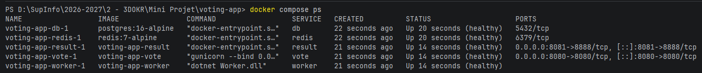

Accès
Vote : http://localhost:8080
Résultats : http://localhost:8081

Page de vote

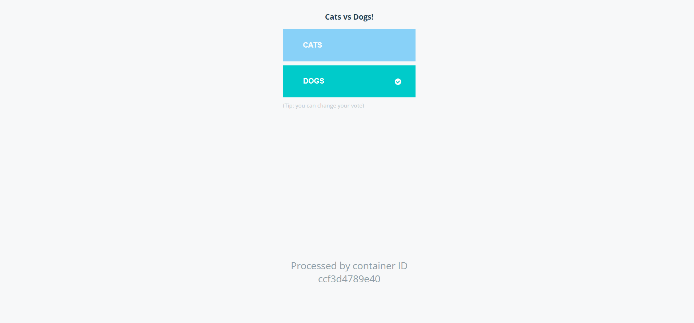

Page des résultats

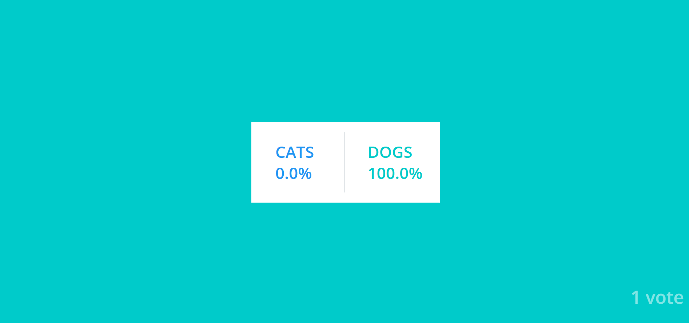
Tests réalisés

Persistance des données

bash
docker compose down
docker compose up -d

Les votes sont toujours affichés sur http://localhost:8081 après le redémarrage. À ne pas faire : docker compose down -v, qui supprime les volumes et donc les données.

Isolation des réseaux

bash
docker compose exec vote python -c "import socket; print(socket.gethostbyname('db'))"
docker compose exec result wget -qO- http://redis:6379

Les deux commandes échouent (le nom n'est pas résolu) : vote ne voit pas la base, result ne voit pas Redis.

Test d'isolation

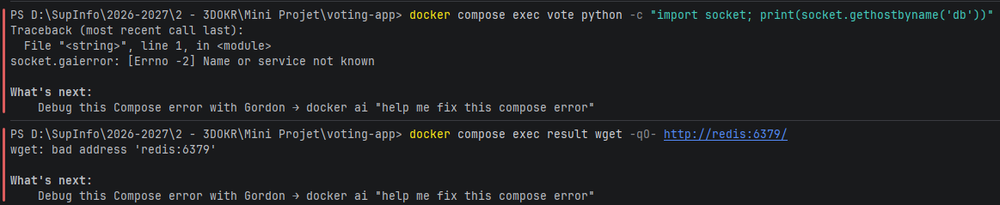

Dépendances

depends_on avec condition: service_healthy impose l'ordre de démarrage : vote attend redis, result attend db, worker attend les deux. Si une base ne répond pas, les services qui en dépendent attendent au lieu de planter. Avec restart: unless-stopped, un conteneur qui s'arrête est relancé.

bash
docker compose stop db
docker compose ps
docker compose start db
Arrêt
bash
docker compose down        # arrête et supprime les conteneurs, garde les volumes

4. Déploiement sur un cluster Docker Swarm

Le cluster est composé de 3 VM Ubuntu 22.04 créées avec Vagrant et VMware Workstation. Docker est installé directement dans chaque VM : on n'utilise pas Docker dans Docker.

VM	IP	Rôle
manager	192.168.56.10	Manager Swarm, registry locale, Redis et PostgreSQL
worker1	192.168.56.11	Worker
worker2	192.168.56.12	Worker
4.1 Prérequis sur le PC (Windows)
Installer Vagrant : winget install Hashicorp.Vagrant, puis redémarrer (ou rouvrir le terminal) pour recharger le PATH.
Installer Vagrant VMware Utility (https://developer.hashicorp.com/vagrant/install/vmware, installateur .msi).
Installer le plugin :
powershell
vagrant plugin install vagrant-vmware-desktop
vagrant plugin list
VMware Workstation doit être installé. Quitter Docker Desktop pendant l'utilisation du cluster, car il peut entrer en conflit avec VMware.
4.2 Création des 3 VM

À la racine du projet, sur PowerShell :

powershell
vagrant up --provider=vmware_desktop
vagrant status

La première fois, comptez 10 à 15 minutes. Les 3 VM doivent être running.

vagrant status

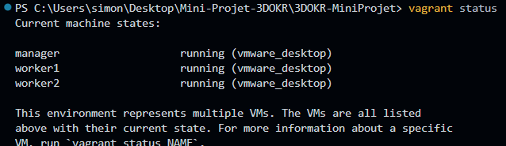

4.3 Accès réseau depuis Windows (spécifique à VMware)

Dans notre cas, la carte VMware Network Adapter VMnet3 n'avait pas d'adresse sur le sous-réseau 192.168.56.0/24, et 192.168.56.10 ne répondait pas (timeout). Correction, dans un PowerShell administrateur sur le PC (pas dans une VM) :

powershell
New-NetIPAddress -InterfaceAlias "VMware Network Adapter VMnet3" -IPAddress 192.168.56.1 -PrefixLength 24
ping 192.168.56.10

Si cette adresse existe déjà, ce n'est pas une erreur. Selon la machine, le nom de la carte peut changer : on le trouve avec ipconfig.

4.4 Initialisation du Swarm

powershell
vagrant ssh manager

Sur le manager :

bash
docker swarm init --advertise-addr 192.168.56.10

Copier la commande docker swarm join --token ... 192.168.56.10:2377 affichée (elle se retrouve avec docker swarm join-token worker). Puis, dans deux autres terminaux :

powershell
vagrant ssh worker1
bash
docker swarm join --token <TOKEN> 192.168.56.10:2377   # ajouter sudo si "permission denied"
exit

Même chose sur worker2. De retour sur le manager :

bash
docker node ls

Les 3 nœuds doivent être Ready (le manager est Leader).

docker node ls

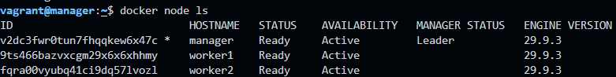

4.5 Registry locale, construction et publication des images

Swarm ne construit pas d'images : il les récupère dans une registry. On en déploie une sur le manager :

bash
docker service create --name registry --constraint node.role==manager \
  --publish published=5000,target=5000 registry:2

cd /vagrant
for app in vote worker result; do
  docker build -t 127.0.0.1:5000/voting-app/$app:1.0 ./$app
  docker push 127.0.0.1:5000/voting-app/$app:1.0
done

curl http://127.0.0.1:5000/v2/_catalog

Le dossier du projet est partagé avec les VM dans /vagrant. Le catalogue doit lister voting-app/vote, voting-app/worker et voting-app/result.

Catalogue de la registry

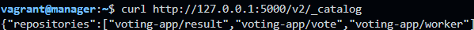

4.6 Déploiement de la stack
bash
docker stack deploy -c docker-stack.yml voting-app
docker stack services voting-app
docker stack ps voting-app

Attendre 1/1 pour redis et db, et 2/2 pour vote, worker et result.

docker stack services

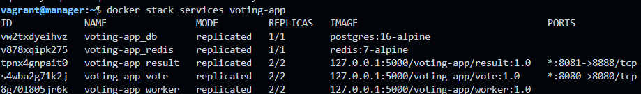

docker stack ps avant la panne

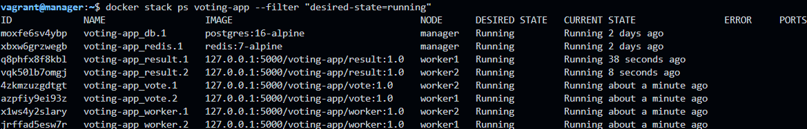

Accès depuis le navigateur du PC :

Vote : http://192.168.56.10:8080
Résultats : http://192.168.56.10:8081

Le mode « routing mesh » de Swarm rend ces ports accessibles sur l'IP de n'importe quel nœud. En rechargeant la page de vote, le container ID affiché en bas alterne entre les 2 réplicas.

Vote sous Swarm

4.7 Différences entre docker-compose.yml et docker-stack.yml
Sujet	Compose	Stack Swarm
Images	build:	image: 127.0.0.1:5000/voting-app/<service>:1.0 (Swarm ne construit pas)
Réseaux	bridge	overlay (communication entre les VM)
Réplicas	1 par service	2 pour vote, worker et result (deploy.replicas)
Redémarrage	restart: unless-stopped	deploy.restart_policy
Dépendances	depends_on avec healthcheck	Ignoré par Swarm : le worker se reconnecte seul à Redis et à PostgreSQL
Placement	libre	redis et db fixés sur le manager (leurs volumes sont locaux à un nœud)
Mises à jour	n/a	update_config (un réplica à la fois, 10 s d'écart)
Variables	fichier .env	valeurs par défaut ${VAR:-valeur} (docker stack deploy ne lit pas .env)
4.8 Test de panne d'un nœud

Sur le PC, on arrête worker1 :

powershell
vagrant halt worker1

Sur le manager :

bash
docker node ls
docker stack ps voting-app
docker stack services voting-app

worker1 passe à Down, ses tâches sont recréées sur manager et worker2, et tous les services reviennent à leur nombre de réplicas.

docker node ls pendant la panne

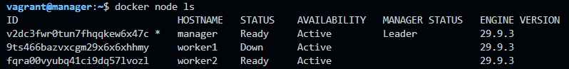

docker stack ps après la panne

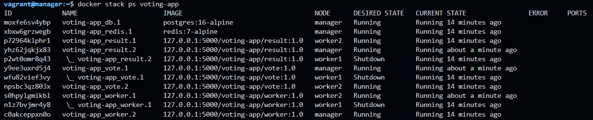

Les deux applications restent accessibles, y compris via l'IP d'un autre nœud :

http://192.168.56.10:8080 et http://192.168.56.10:8081
http://192.168.56.12:8080 et http://192.168.56.12:8081

Sites accessibles pendant la panne

Remise en route du nœud :

powershell
vagrant up worker1

Swarm ne rééquilibre pas automatiquement les tâches déjà recréées. Pour le faire : docker service update --force voting-app_vote (idem pour result). Dans docker stack ps, les lignes \_ ... Shutdown sont l'historique des anciennes tâches, pas des erreurs. Pour n'afficher que les tâches actives :

bash
docker stack ps voting-app --filter "desired-state=running"
4.9 Nettoyage
bash
docker stack rm voting-app        # sur le manager
powershell
vagrant destroy -f                # sur le PC

5. Choix techniques et bonnes pratiques
Dockerfiles
Pratique	vote	worker	result
Image de base légère et version fixée	python:3.11-slim	SDK dotnet/sdk:7.0 pour construire, dotnet/runtime:7.0 pour exécuter	node:18-alpine
Build multi-stage (SDK absent de l'image finale)	n/a	oui	n/a
Dépendances copiées avant le code (cache Docker)	oui	oui	oui
Utilisateur non-root	appuser	appuser	node
.dockerignore	oui	oui	oui
HEALTHCHECK	requête HTTP sur /	fichier « heartbeat » récent (le worker n'expose aucun port)	requête HTTP sur /healthz
Serveur adapté à la production	gunicorn (au lieu du serveur de développement Flask)	n/a	node lancé directement (reçoit les signaux d'arrêt)
Versions des dépendances figées	requirements.txt	Worker.csproj	package-lock.json et npm ci
Configuration par variables d'environnement

Les hôtes ne sont plus codés en dur sur localhost : REDIS_HOST, DB_HOST, DB_USER, DB_PASSWORD. Les mêmes images fonctionnent donc avec Compose et avec Swarm.

6. Liste des modifications du code source

Module	Fichier	Modification	Raison
vote	app.py	Hôte Redis lu dans REDIS_HOST (défaut localhost)	Les conteneurs se joignent par leur nom de service
vote	app.py	Mode debug de Flask désactivé par défaut (variable FLASK_DEBUG)	Le mode debug est dangereux en production
vote	requirements.txt	Versions figées (Flask, redis) et ajout de gunicorn	Build reproductible, serveur de production
worker	Program.cs	Hôtes et identifiants lus dans DB_HOST, DB_USER, DB_PASSWORD, REDIS_HOST	Idem
worker	Program.cs	Écriture d'un fichier « heartbeat » toutes les 5 s	Permet le HEALTHCHECK sans port HTTP
worker	Program.cs	Correction d'un bug : après une reconnexion à PostgreSQL, le vote en cours était perdu et la commande « keep-alive » restait liée à l'ancienne connexion	Fiabilité
result	server.js	Connexion PostgreSQL construite avec DB_HOST, DB_USER, DB_PASSWORD	Idem
result	server.js	Ajout de la route GET /healthz	HEALTHCHECK
racine	.gitignore	Ajout de .env et .vagrant/	Ne pas versionner les secrets ni les VM
racine	run/	Dossier supprimé	Remplacé par Docker Compose (voir section 7)

Les fonctionnalités principales de l'application ne sont pas modifiées. Le détail est dans l'historique Git.

7. Correspondance avec les anciens scripts run/

Script supprimé	Remplacé par
step-1.bash (Redis)	Service redis du Compose (redis:7-alpine, volume redis-data)
step-2.bash (vote : pip install, python app.py)	vote/Dockerfile (pip install, puis gunicorn qui lance la même application Flask sur le port 8080)
step-3.bash (PostgreSQL)	Service db du Compose (postgres:16-alpine, mêmes variables POSTGRES_*, volume db-data)
step-4.bash (worker : dotnet restore, publish, exécution)	worker/Dockerfile (mêmes commandes dans un build multi-stage)
step-5.bash (result : npm install, npm start)	result/Dockerfile (npm ci, puis node server.js, ce que lance npm start)
reset.bash (supprime node_modules, bin, obj)	Inutile : ces dossiers n'existent que dans les images et sont exclus par .dockerignore

8. Limites et pistes d'amélioration

Un seul manager (imposé par le sujet) : si le manager tombe, on perd l'administration du cluster. En production, on utiliserait 3 managers.
Redis et PostgreSQL sont fixés sur le manager, car leurs volumes sont locaux à un nœud. Si le manager tombe, il n'y a plus de base. Améliorations possibles : volume partagé (NFS), réplication PostgreSQL, Redis Sentinel.
Mot de passe PostgreSQL dans une variable d'environnement : en production, utiliser Docker secrets.
Registry en HTTP sur 127.0.0.1 : acceptable pour un TP, à remplacer par une registry sécurisée (TLS) en production.
L'adresse 192.168.56.1 ajoutée à la carte VMware n'est pas forcément conservée après un redémarrage de Windows : relancer la commande de la section 4.3 si besoin.